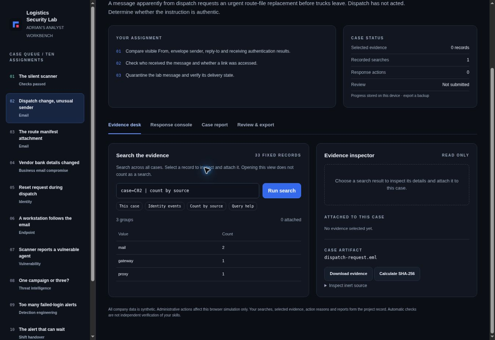
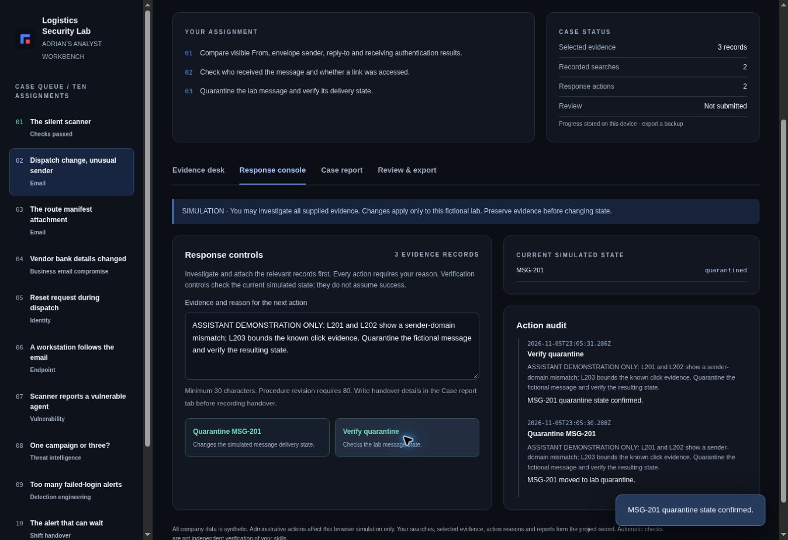

# Logistics Security Lab

Independent learning project | Adrian Anoceto

Snapshot exported: 2026-11-10T00:45:29.492Z

## What this project is
A browser-based SOC and email security training project using a fictional logistics company. The lab was designed and implemented with AI assistance. The learner's investigations, answers, notes and simulated actions are recorded separately.

Live lab: https://adrian-logistics-security-lab.awesomeadrian54.chatgpt.site/

## Recorded progress
10 of 10 guided lessons completed; 34 answer attempts; 34 simulated actions; 10 learner notes.

Completed guided lessons:
- Check a suspicious email
- Check an attachment safely
- Check a payment-change request
- Help recover an account
- Check a suspicious computer
- Fix a missing security signal
- Fix a fictional software weakness
- Find connected suspicious messages
- Make an alert less noisy
- Hand work to the next analyst

## Evidence to inspect
- reports/: learner notes, answer attempts and simulated action records for started lessons.
- evidence/timeline.json and timeline.md: timestamps and provenance of recorded activity.
- evidence/scenarios.json: the fictional records supplied to the learner.
- lab/: the application source for this export.
- manifest.json: SHA-256 file hashes for detecting later changes. These are checksums, not signatures or independent proof of completion.

## Demonstration screenshots

These screenshots show an assistant-run example of the simulated lab workflow. The lesson reports and activity log document the learner’s completed run separately.

Evidence search results grouped by source in the simulated case.

Simulated quarantine action, its verification, and the action history.

## Run the source
Serve the lab folder using a static HTTP server and open index.html. For example, with Python installed: cd lab, then python3 -m http.server 8000. Open http://localhost:8000. Progress remains in the browser. Run npm test from the lab folder to run the included tests. No dependency installation is needed.

## Responsibility mapping
- AegisAI · Email, URL and attachment investigation
- UM · Initial incident triage
- UM + AegisAI · Investigation records
- UM · Protect assets and follow authority
- UM + AegisAI · Threat intelligence
- AegisAI · Customer guidance
- UM · Escalate high-risk incidents
- UM · Identity and access verification
- UM · Monitor alerts and verify visibility
- UM + AegisAI · Follow and improve procedures
- UM · Vulnerability management
- AegisAI · Reporting and pattern analysis
- UM + AegisAI · Tune and test detections
- UM · Shift and on-call handover practice

The mapping describes guided simulated practice. It does not establish proficiency in a production tool.

## What I can show
My own written notes and choices, the fictional evidence supplied, the response controls I used, and the results the lab engine recorded. Activity is self-reported through browser storage and can be edited or imported. No identity verification or independent assessment is provided.

## Limits
Guided explanations, automatic evidence attachment, supplied action reasons and the example handover are assistance. They are not learner-authored analysis. This is not UPS work experience, employment at UM or AegisAI, real Microsoft 365 administration, real endpoint patching, a live malware sandbox or certification.

## Personal project notes
No additional learner notes entered yet.

## References
Curriculum uses the user-supplied UM IT Security Associate R100102833 responsibilities and https://www.aegisai.com/careers/email-security-analyst-ai-operations (reviewed November 5, 2026). Incident-response reference: https://csrc.nist.gov/pubs/sp/800/61/r3/final. Account-response reference: https://learn.microsoft.com/en-us/defender-office-365/responding-to-a-compromised-email-account. These organizations do not endorse this project.
